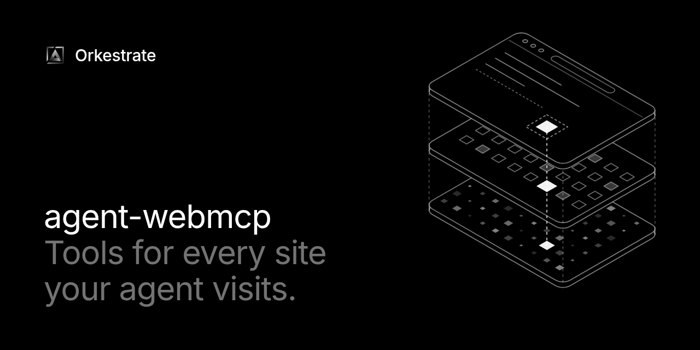

<p align="center">
  
</p>

<p align="center">
  <a href="https://www.npmjs.com/package/@orkestrate/agent-webmcp"></a>
  <a href="LICENSE"></a>
  <a href="https://web.orkestrate.space/webmcp/sites"></a>
</p>

# agent-webmcp

Your agent is clicking through pages that already have typed tools.
agent-webmcp tells it which ones before it opens them.

Sites can now register [WebMCP](https://github.com/webmachinelearning/webmcp)
tools: named functions with a description and an input schema, callable from
the page. An agent that calls `searchFlights({origin, destination, ...})`
skips the screenshots, the guessed selectors and the retries. The catch is
that nothing tells the agent which sites have tools, so it drives the page
by hand anyway.

agent-webmcp is that missing lookup. One call, before the agent opens a
page:

```console
$ agent-webmcp find "search flights"
googlechromelabs.github.io/searchFlights  [unspecified]
    Searches for flights with the given parameters.
    open https://googlechromelabs.github.io/webmcp-tools/demos/react-flightsearch/
```

| Without agent-webmcp | With agent-webmcp |
|---|---|
| Open the page, snapshot, find the form, type into each field, click search, snapshot again to check | `find` names the page and tool, open it, call `searchFlights` once with typed arguments |
| Breaks when the layout changes | Calls the interface the site publishes for agents |
| Never learns the site had a tool | Knows before the page loads |

It works with the browser driver you already use: agent-browser, Playwright
MCP, Chrome DevTools MCP or OpenCode Browse. agent-webmcp never opens pages
or calls tools itself; your driver does. When nothing matches, `find` says
so, and the agent uses its driver as usual.

## Quickstart

Install one of two ways:

| | |
|---|---|
| curl (Linux, macOS) | `curl -fsSL https://web.orkestrate.space/webmcp/install \| bash` |
| npm (any OS) | `npm i -g @orkestrate/agent-webmcp` |

Then run first-run setup:

```console
$ agent-webmcp setup
```

The curl script installs one checksum-verified binary to `~/.local/bin`
and never edits your shell profile; it tells you if that folder is not on
your PATH. Both installs upgrade with `agent-webmcp upgrade`.

`setup` downloads the index, installs the agent skill (Claude Code, OpenCode
and any `~/.agents` client), adds the MCP server to OpenCode, and prints
one-line installs for Claude Code and Codex:

```console
$ claude mcp add agent-webmcp -s user -- agent-webmcp mcp
$ codex mcp add agent-webmcp -- agent-webmcp mcp
```

Some drivers need a flag to turn WebMCP on. [docs/drivers.md](docs/drivers.md)
has the setup for each one, checked on 18 Nov 2026.

Or skip all of this: the **Copy prompt** button on
[web.orkestrate.space/webmcp](https://web.orkestrate.space/webmcp) gives your
agent a prompt that installs and checks everything itself.

## Check a site, a URL or a task

```console
$ agent-webmcp find cal.com
cal.com/ask_cal_com  [unspecified]
    Ask a question about Cal.com (plans, features, integrations, self-hosting, the API) and get an answer grounded in the documentation.
    open https://cal.com/

$ agent-webmcp find stripe.com
No indexed site has a tool for "stripe.com". Use your browser driver as usual.
```

Site lookup is the main use: your agent already knows where it is going.
Task search covers the sites in the index. Add `--json` for each tool's
input schema.

## The directory

Every indexed site and its tools are listed at
[web.orkestrate.space/webmcp/sites](https://web.orkestrate.space/webmcp/sites).
A bot rechecks every site weekly in a fresh Chromium, so listings reflect
what pages register today.

**Own a site with WebMCP tools?** Paste its URL into **Add your site**. The
bot checks it and lists it within a couple of minutes, with no account or
ownership proof needed. [CONTRIBUTING.md](CONTRIBUTING.md) has the rules.
Owners can ask for removal at support@orkestrate.space.

## Commands

| Command | What it does |
|---|---|
| `find <site, URL or task>` | Check a site first, or search by task. `--json` for machine output. |
| `setup` | First run: index, skill, MCP wiring, driver notes. |
| `mcp` | Run an MCP server with one tool, `find`. |
| `update` | Check for a newer index now (it also checks hourly). |
| `upgrade [version]` | Upgrade agent-webmcp itself the way you installed it (latest by default). |
| `status` | Show the index in use and where it came from. |

How matching, listing and index updates work: [docs/index.md](docs/index.md).

## Next

Planned for 0.3, not shipped yet:

- **`call`**: open the page and call a site's tool in one command, from the
  CLI or the MCP server. Tools marked consequential will need explicit
  confirmation.
- **Registry**: `agent-webmcp add` for reviewed, versioned items, pinned in a
  lockfile and kept current with `outdated` and `update`.

Watch the repo or follow the [changelog](CHANGELOG.md) to hear when they land.

## Privacy

No analytics. The CLI fetches only the public index (hourly, or on demand
with `update`), and the index server stores nothing about who reads it. Site
submissions keep the submitted URL and a salted hash of the submitter's IP
for rate limiting.

## Contributing

Build from source with `cargo build --release`; the result is the same
binary npm ships. Bugs go in [issues](https://github.com/orkestrate-dot-space/agent-webmcp/issues),
security reports to [SECURITY.md](SECURITY.md). v1 is preserved on the
`archive/v1-main` branch.

## License

MIT
